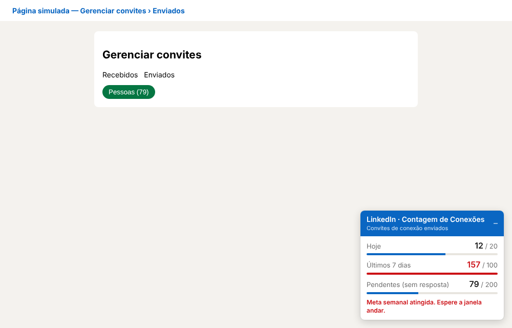
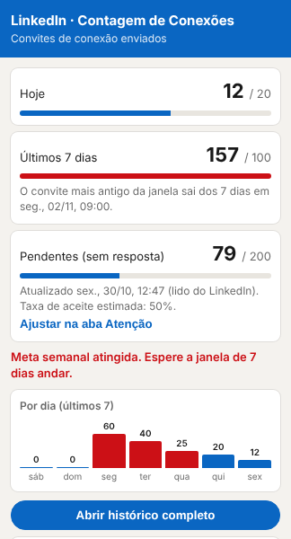

# LinkedIn · Contagem de Conexões

Extensão do Chrome que conta os convites de conexão que você envia no LinkedIn, para manter um ritmo seguro e não bater no limite semanal.

Ela só **lê** a página: não clica, não envia nada e não usa servidor. Tudo fica no seu navegador (`chrome.storage.local`).

<p>
  
  
</p>

## O que faz

- **Contagem de hoje e dos últimos 7 dias** (janela móvel), com metas configuráveis (padrão: 20 por dia e 100 por semana).
- **Cartão fixo em toda aba do LinkedIn**, atualizado ao vivo em todas as abas, e número do dia no ícone.
- **Histórico permanente** com nome, cargo, empresa e link do perfil de cada convite. Filtros por dia, semana e mês, busca, filtro por empresa, aba **Empresas** e exportação em CSV.
- **Aprende com os avisos do LinkedIn**: quando aparece "prestes a atingir o limite semanal de convites", registra a contagem daquele momento e sugere metas 20% abaixo (aba **Atenção**).
- **Convites pendentes e taxa de aceite**: lê "Pessoas (N)" em *Gerenciar convites › Enviados* e "Conexões N" em *Minha rede*.
- **Modo teste**: mostra o que a extensão leu na página, sem contar nada.
- **Backup e restauração** do histórico (arquivo JSON).
- **Aviso de nova versão**: compara a versão instalada com o `manifest.json` deste repositório. Só funciona se o repositório for público.

## Instalar

```bash
git clone https://github.com/MathSMB/plugin-linkedin-contagem-conexoes.git
```

1. Abra `chrome://extensions` e ligue o **Modo do desenvolvedor** (canto superior direito).
2. Clique em **Carregar sem compactação** e escolha a pasta `plugin-linkedin-contagem-conexoes`.
3. Fixe o ícone na barra (quebra-cabeça › alfinete) e dê F5 nas abas do LinkedIn.

## Atualizar

```bash
cd plugin-linkedin-contagem-conexoes
git pull
```

Depois clique no ícone de **recarregar** da extensão em `chrome://extensions` e dê F5 no LinkedIn. Use sempre a **mesma pasta**: o histórico continua salvo.

> ⚠️ O histórico fica preso à extensão instalada. Se você **remover** a extensão ou carregar uma **pasta diferente**, ela vira outra extensão e começa vazia. Antes de trocar de pasta ou de computador, faça **Histórico › Fazer backup** e depois **Restaurar backup** na nova instalação.

## Estrutura

| Arquivo | Papel |
| --- | --- |
| `manifest.json` | Configuração da extensão (Manifest V3) |
| `content.js` | Roda dentro das abas do LinkedIn: detecta "Convite enviado", o aviso de limite e os números da rede, e desenha o cartão |
| `background.js` | Service worker: recebe os eventos, grava no storage, calcula a sugestão de metas e checa atualizações |
| `common.js` | Funções compartilhadas (estatísticas, empresa a partir do título, sugestão) |
| `popup.*` | Janela do ícone |
| `history.*` | Página de histórico (Convites, Empresas, Atenção) |

## Limitações

- O LinkedIn muda o HTML com frequência. Se algo deixar de ser detectado, use o **Modo teste** para ver o que a extensão está lendo e o **+1 manual** no popup.
- A empresa é deduzida do título da pessoa ("… na Itaú", "… at Nubank", "Atual: …"). Quando não dá, você pode digitar no histórico.
- O LinkedIn não publica os limites. As metas sugeridas são estimativas a partir dos seus próprios avisos.
